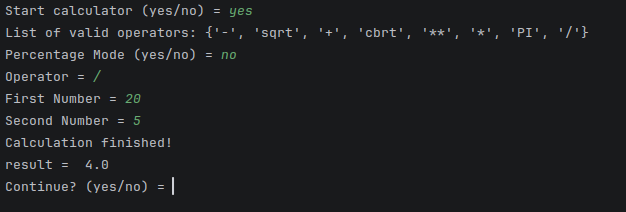

# Python Calculator

A command-line calculator built with Python, designed to practise programming fundamentals while creating a useful everyday tool.


## Features

- Addition, subtraction, multiplication, and division
- Exponentiation
- Square roots and cube roots
- Multiplication by pi
- Percentage calculations
- Numeric input validation
- Division-by-zero checking
- Option to perform multiple calculations

## How to install:

### Requirements

- Python 3.11 or newer

### Installation

1. Clone this repository:

   ```bash
   git clone https://github.com/bungalaowhagawatzgalow-cyber/python-calculator.git
   ```

2. Open the project directory:

   ```bash
   cd python-calculator
   ```

3. Run the calculator:

   ```bash
   python calculator.py
   ```

## Built With

- **Python** — core programming language
- **`math`** — mathematical functions and constants
- **`time`** — simple delays in the command-line experience

## What I Learned

This project helped me practise:

- Functions and dictionaries
- Lambda expressions
- Conditional statements and loops
- User input and type conversion
- Exception handling
- Git and GitHub version control

## Future Improvements

- [x] Fix and test all percentage-mode edge cases
- [ ] Improve invalid operator handling
- [ ] Add a graphical user interface
- [ ] Add automated tests

## License

This project is licensed under the MIT License. See [LICENSE](LICENSE) for details.

## Preview



---

*Built as part of my journey learning Python and software development.*
